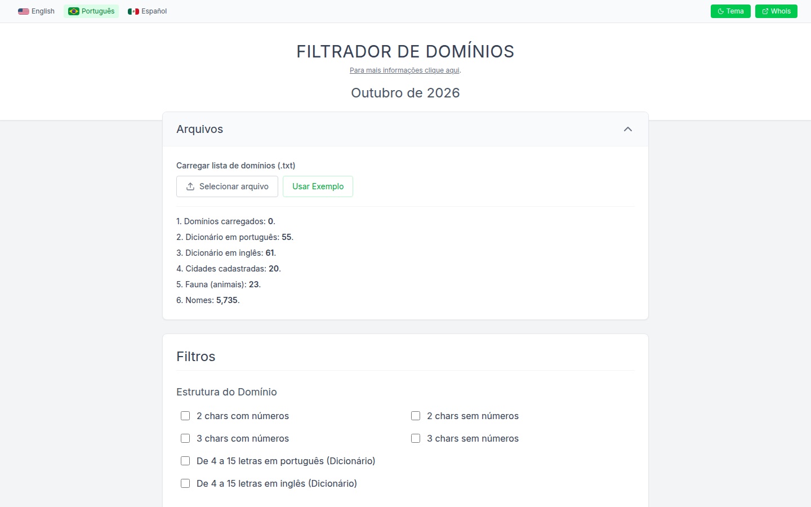
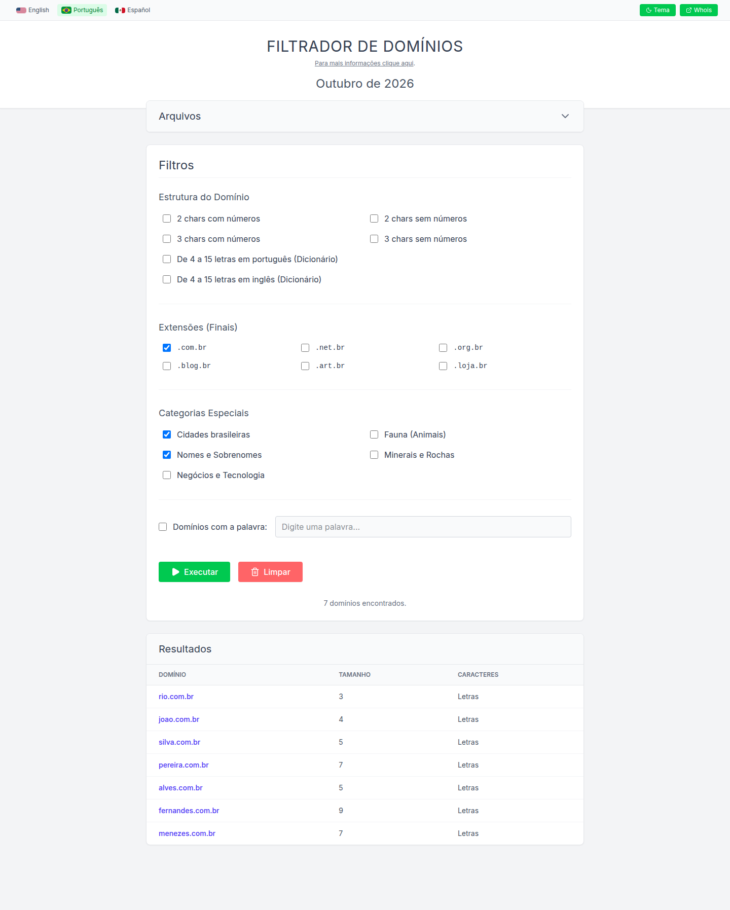
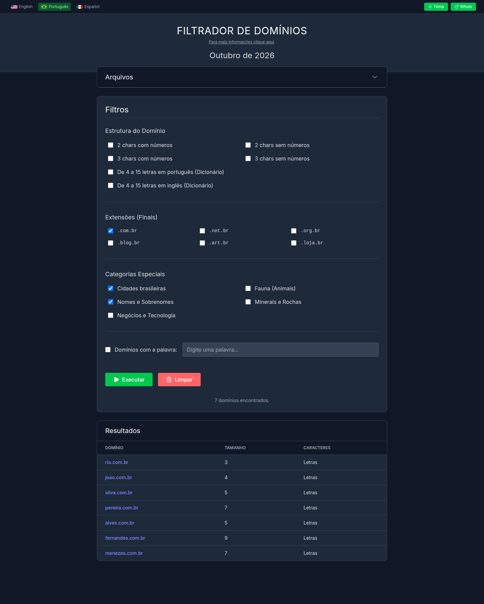
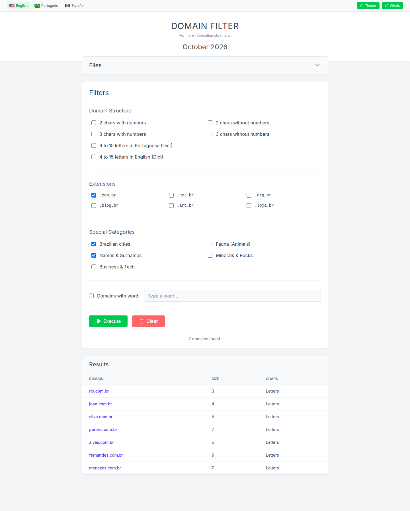
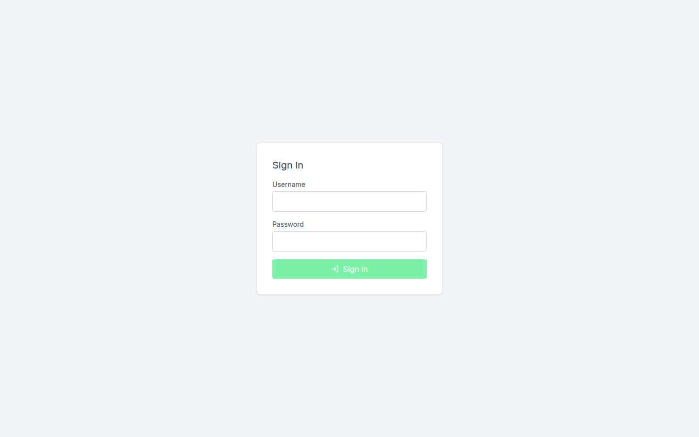
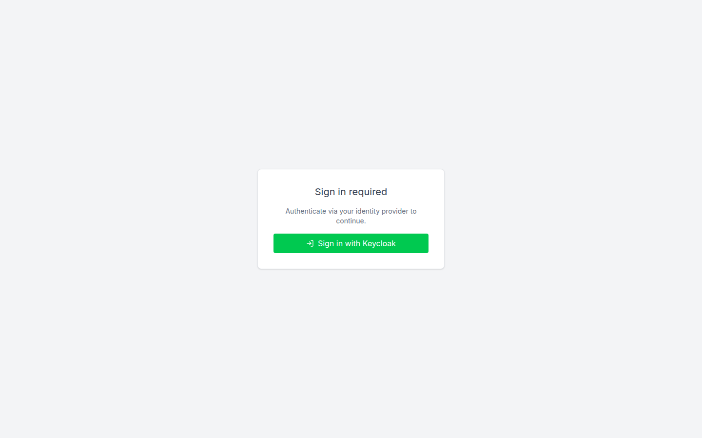
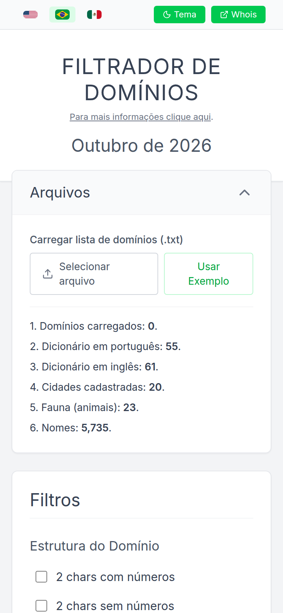

<div align="center">

</div>

# Domain Analysis

This contains everything you need to run your app locally.

## Tech stack

- React 19 + TypeScript, bundled with Vite 8
- Tailwind CSS v4
- Express 4 serving the built frontend (`dist/`) and the `/api` endpoints

## Prerequisites

- Node.js `^20.19.0` or `>=22.12.0` (required by Vite 8)
- npm 10 or newer
- Docker + Docker Compose (only for the container image)

## Screenshots

| Home (light) | Filters and results |
| --- | --- |
|  |  |

| Dark theme | English UI |
| --- | --- |
|  |  |

| Account login | Keycloak login | Mobile |
| --- | --- | --- |
|  |  |  |

The screenshots were captured from a production build using the built-in sample domain list. See
[docs/screenshots/README.md](docs/screenshots/README.md) for what each image shows and how to reproduce them.

## Run Locally

1. Install dependencies:
   `npm install`
2. Build the frontend and start the app:
   `npm run build`
   `npm start`
3. Open http://localhost:3000

For frontend development with hot reload, run the API and the Vite dev server side by side:

```bash
npm start      # terminal 1: API on :3000
npm run dev    # terminal 2: UI on :5173, /api is proxied to :3000
```

Then open http://localhost:5173.

## Run with Docker

The published image is `ghcr.io/ivancarlosti/domainanalysis:latest`.

```bash
cd docker
cp .env.example .env   # then adjust the values
docker compose up -d
```

`PORT` in `docker/.env` is the port published on the host (default `8080`); the container itself always listens on `3000`.
`docker/.env` is git-ignored, so real credentials never end up in version control.

## Configuration

The server is configured through environment variables; the defaults are shown below. Locally, export them in your
shell. With Docker Compose they are read from `docker/.env` (see `docker/.env.example`).

| Variable | Default | Description |
| --- | --- | --- |
| `PORT` | `3000` | Port the Express server listens on. In `docker/.env` this is the host port used by the compose port mapping. |
| `AUTH_METHOD` | `none` | Authentication mode: `none`, `account` or `keycloak`. |
| `ACCOUNT_LOGIN` | empty | Username for `AUTH_METHOD=account`. |
| `ACCOUNT_PASSWORD` | empty | Password for `AUTH_METHOD=account`. |
| `RECAPTCHA_CLIENTID` | empty | reCAPTCHA site key. When set together with the secret, reCAPTCHA is enforced on account login. |
| `RECAPTCHA_CLIENTSECRET` | empty | reCAPTCHA secret key. |
| `KEYCLOAK_BASE_URL` | empty | Keycloak base URL, e.g. `https://sso.example.com`. |
| `KEYCLOAK_REALM` | empty | Keycloak realm name. |
| `KEYCLOAK_CLIENT_ID` | empty | Keycloak client ID. |
| `KEYCLOAK_CLIENT_SECRET` | empty | Keycloak client secret. |
| `KEYCLOAK_REDIRECT_URI` | empty | Public base URL of this app. The callback registered in Keycloak is this value plus `/api/auth/keycloak/callback`. |
| `KEYCLOAK_EMAIL_ACCOUNT` | empty | Account label shown as signed in after Keycloak login. |
| `SESSION_SECRET` | random | Secret used to sign the session cookie. Generate one with `openssl rand -hex 32`; when unset, a random secret is created at startup and sessions do not survive a restart. |
| `RATE_LIMIT_WINDOW_MS` | `60000` | Length of the rate limiting window, in milliseconds, per client IP. |
| `RATE_LIMIT_MAX` | `300` | Maximum requests per client IP per window. Applied to every route: API, static assets and the SPA fallback. |
| `LOGIN_RATE_LIMIT_MAX` | `10` | Failed `POST /api/auth/login` attempts allowed per client IP per 15-minute window. Successful logins are not counted. |
| `TRUST_PROXY` | empty | Value for Express's `trust proxy` setting: a hop count such as `1`, or a list such as `loopback, linklocal`. Set it when the app runs behind a reverse proxy. |
| `DOMAIN` | empty | Informational only, read by the reverse proxy template, not by the app. |

## Security notes

- All routes are rate-limited with `express-rate-limit` using its in-memory store: counters reset when the process restarts and are not shared between replicas. Multi-instance deployments should use a shared store or an edge limiter.
- `npm audit` reports no known vulnerabilities. The `proxy-addr` IP-spoofing advisory (GHSA-jqcg-44mw-7w3h) is fixed by
  `proxy-addr@2.0.8`, and the `body-parser` DoS advisory (GHSA-27r3-jxmh-p828) by `body-parser@1.20.9`;
  `express@4.22.3` brings in both, together with `qs@6.16.1`.
- The server does not enable Express `trust proxy`. If you deploy behind a reverse proxy and need real client IPs,
  set `TRUST_PROXY` to that proxy's hop count or address ranges instead of turning it on globally; otherwise every
  client is rate-limited under the proxy's IP.
- Tailwind CSS v4 output requires Safari 16.4+, Chrome 111+ or Firefox 128+.
